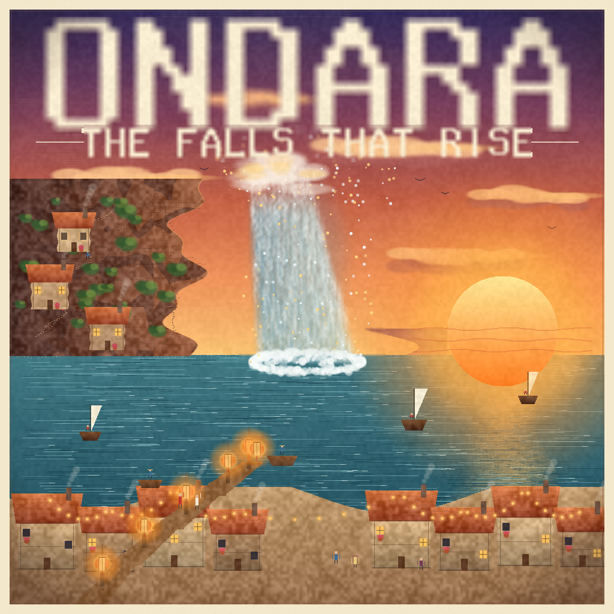

# ONDARA — The Falls That Rise

[](https://make.fun/bounty/the-poster-for-a-place-that-i-2-20261121-0539?utm_source=github&utm_medium=readme&utm_campaign=the-poster-for-a-place-that-i-2-20261121-0539)
[](https://make.fun/bounty/the-poster-for-a-place-that-i-2-20261121-0539/leaderboard?utm_source=github&utm_medium=readme&utm_campaign=the-poster-for-a-place-that-i-2-20261121-0539)
[](https://make.fun/bounty/the-poster-for-a-place-that-i-2-20261121-0539?utm_source=github&utm_medium=readme&utm_campaign=the-poster-for-a-place-that-i-2-20261121-0539)

[The Poster for a Place That Isn't There](https://make.fun/bounty/the-poster-for-a-place-that-i-2-20261121-0539) — make.fun

A painterly-realistic travel poster for **ONDARA — "THE FALLS THAT RISE"**: a colossal waterfall flowing *up* from the sea into the sky above a dense coastal fishing town at sunset — textured cliffs with ledge cottages, a wooden pier with glowing paper lanterns, a big low sun with a golden glitter path, real small people looking up, sailboats and a rowing fisherman, retro grain, cream frame.

## Run

```sh
python3 main.py   # writes /output/entry.png (and ./entry.png)
```

Pure Python 3.13 standard library only — no network, fixed seed, deterministic (byte-identical across runs). Output: exactly 1024×1024 PNG, under 1 MiB.

## Preview


